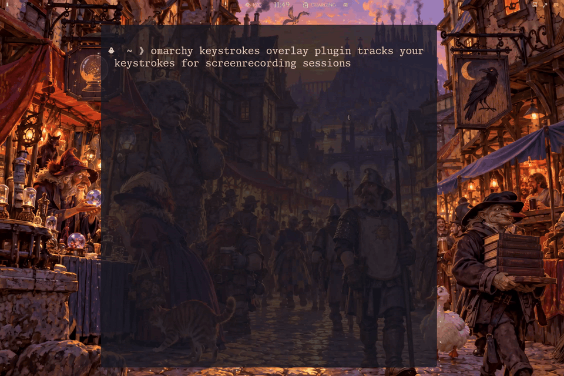

# Keystrokes



An [Omarchy](https://omarchy.org/) plugin that shows keypresses as themed
keycaps for screencasts, streams, and demonstrations, without taking focus.
Choose the position, monitor, size, duration, and display order from the bar.

## Requirements

- Omarchy with Quickshell and Lua-based Hyprland configuration
  (tested with Hyprland 0.56.2).
- Standard Bash/coreutils and the desktop session's private, memory-backed
  `$XDG_RUNTIME_DIR`.
- `rsync` — only for the local installer.

## Install

Run `omarchy plugin add` and enter this repository's public Git URL, or use
its listing in the [Omarchy plugin portal](https://plugins.omarchy.org/).
Then enable the plugin and its bar button:

```bash
omarchy plugin enable markpriem.keystrokes right
```

**OPTIONAL** if you want to install from a local checkout, run `./install.sh` there. I use it for development work and pinning versions. It requires `rsync`
and copies your checkout, including uncommitted edits. Reinstalling prompts
before replacing installed plugin files and deleting extra files;
`./install.sh --replace` skips that prompt. Again: fully optional!!

After either installation method, manually add this line to
`~/.config/hypr/bindings.lua`:

```lua
dofile(os.getenv("HOME") .. "/.config/omarchy/plugins/markpriem.keystrokes/hypr/keystrokes.lua")
```

This registers capture bindings and **Super+Shift+K** to toggle capture.
Choose an unused shortcut: to change it, put
`KEYSTROKES_TOGGLE_BIND = "SUPER + SHIFT + J"` before the line above.
Use `KEYSTROKES_NO_BIND = true` instead to omit the toggle shortcut.

```bash
hyprctl reload
hyprctl configerrors
```

## Use

Press **Super+Shift+K** to toggle capture. Click the keyboard button in the
bar to open settings; it is highlighted while capture is active. Capture
starts **off**, including after shell restarts and Hyprland reloads.

Settings include shortcuts only (the default), individual modifiers, repeat
counters, app exclusions, and automatic switch-off. Labels follow physical
US-layout keys; holding a key does not generate repeats. Preferences are
saved in `~/.config/omarchy/keystrokes.json`.

Terminal controls:

```bash
omarchy-shell markpriem.keystrokes on
omarchy-shell markpriem.keystrokes off
omarchy-shell markpriem.keystrokes toggle
omarchy-shell markpriem.keystrokes status
```

Starting returns `starting`; `status` reports `on` once ready. Setup errors
appear in settings. If capture stops responding, it switches off; toggle it
on to retry.

The standard shell lifecycle commands also control capture:

```bash
omarchy-shell shell summon markpriem.keystrokes '{}'
omarchy-shell shell hide markpriem.keystrokes
omarchy-shell shell toggle markpriem.keystrokes '{}'
```

Hide stops capture and dismisses any pause prompt. The bar button opens settings.

### Authentication pauses

**SUDO protection**, enabled by default, pauses capture when you type
`sudo` followed by Space. Capture also pauses whenever Omarchy's polkit
authentication dialog is open. Both clear the displayed keys.

After entering sensitive information and closing any authentication dialog,
click the pause keycap or press your toggle shortcut to resume.

## Under the Hood

Hyprland already handles your keyboard. The plugin uses its built-in Lua
keybinding system to notice keypresses while still letting them reach your
apps. Shortcut and app filters run before events are shared with the overlay.

Selected key codes and modifier keys pass through two small, rotating
temporary files in your session's memory-backed runtime folder. Quickshell
reads these files and draws the keycaps. Stopping capture clears the pending
events and removes the files; there is no permanent typing log or network
transmission.

This reuses Hyprland, Quickshell, and standard system tools. It needs no root
privileges, extra background service, direct access to keyboard devices
(`/dev/input`), or changes to system permissions. For technical details, see
the [capture protocol](docs/protocol.md).

## Privacy

- **Turn capture off before entering secrets.** Password fields are not
  detected; visible keys can also appear in recordings and screen shares.
- Other programs or plugins running as your user could read the temporary
  key stream. File permissions protect against other ordinary users, not
  code sharing your account.
- Shortcuts only and app exclusions reduce exposure; they are not security
  boundaries. Apps with unknown focus are excluded.
- SUDO protection can miss pasted commands, aliases, edits, and other keyboard
  layouts. Polkit protection covers Omarchy's dialog, not every password prompt.
- Capture is suppressed while the session is locked, but may resume after
  unlocking if still enabled. It switches off if the overlay stops responding.
- Crashes can leave temporary files until session cleanup or reboot.
  Memory-backed files can use swap.

## Remove

Stop capture and unload its bindings before removing the plugin:

```bash
omarchy-shell markpriem.keystrokes off
hyprctl eval 'if Keystrokes then if Keystrokes.dispose then Keystrokes.dispose() else Keystrokes.set(false); if Keystrokes._subscription then Keystrokes._subscription:remove() end end end'
```

Remove the `dofile` line and any `KEYSTROKES_TOGGLE_BIND` or
`KEYSTROKES_NO_BIND` assignments from `~/.config/hypr/bindings.lua`, plus any
custom bindings you added. Then run:

```bash
hyprctl reload
hyprctl configerrors
omarchy plugin remove markpriem.keystrokes
```

Preferences are retained. To delete them too:

```bash
rm -f -- "$HOME/.config/omarchy/keystrokes.json"
```

## License

[MIT](LICENSE). Copyright (c) 2026 Mark Priem.
